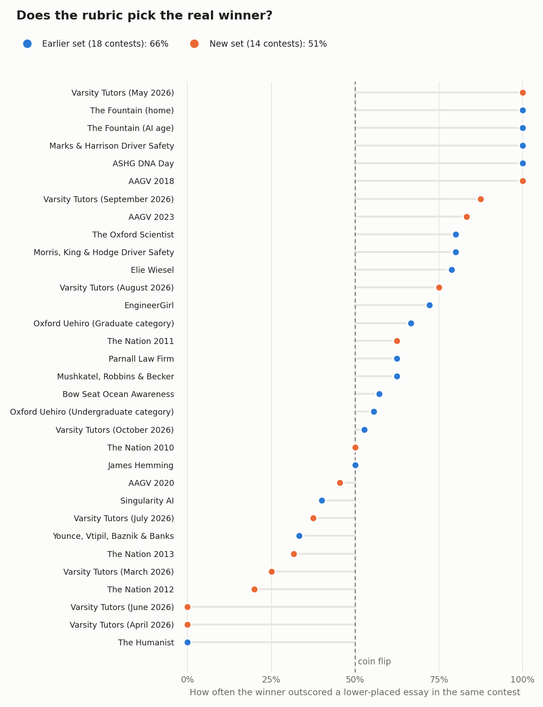
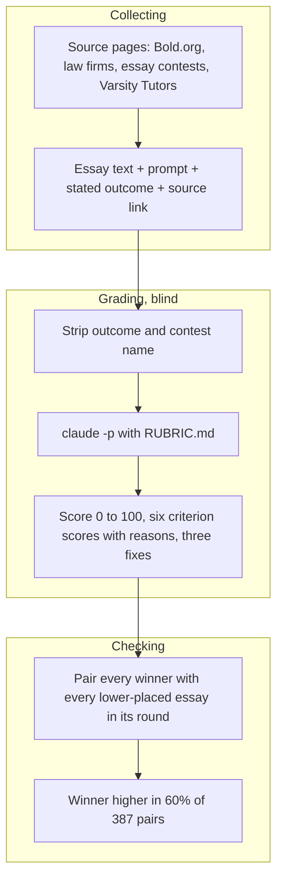

<h1 align="center">Quill Scholarships</h1>

<p align="center"><b>526 real scholarship essays, winners and losers, graded against one rubric.</b><br>
The rubric behind Quill, my scholarship writing desk, scores every essay blind. Then the score is checked against who actually won.</p>

<p align="center">
  
</p>

## How it works

1. **Collect.** Every essay comes from a page that published it: Bold.org winner pages, law-firm scholarship sites, essay contests that post their runners-up and finalists, and Varsity Tutors, which posts every entry along with the winner. Each one keeps its source link, its prompt, and the outcome the source states.
2. **Blind.** The judge sees the prompt, the word limit and the essay. It never sees the outcome, the contest name or the source.
3. **Grade.** `claude -p` scores the essay with [`RUBRIC.md`](RUBRIC.md): six criteria scored 1 to 5, weighted to 100, minus deductions for things like a blown word limit, em dashes, or chatbot residue. It also writes a one-line reason per criterion and three fixes.
4. **Check.** Inside one contest round the prompt and the judges are the same, so the fair test is simple: when a winner and a lower-placed essay share a round, does the winner score higher?

## System design

The grader is the same prompt as the Judge button in Quill, so a score here means the same thing as a score on a draft.



## Results

526 essays from 104 contests: 315 winners, 69 runners-up, 64 finalists, 27 honorable mentions, 46 entries that were not selected, and 5 with no stated outcome. 32 contests have both a winner and a lower-placed essay on the same prompt.

| Same-contest test | Contests | Pairs | Winner scored higher |
|---|---:|---:|---:|
| Earlier set (collected 2026-11-07) | 18 | 241 | 66% |
| New set (collected 2026-11-08) | 14 | 146 | 51% |
| **All** | **32** | **387** | **60%** |

Which criterion separates winners best, over the same 387 pairs:

| Criterion | Weight | Winner scored higher |
|---|---:|---:|
| Answers every part of the prompt | 20 | 62% |
| One or two on-topic stories | 15 | 61% |
| Specific, checkable detail | 20 | 57% |
| Ideas with a mechanism | 15 | 56% |
| Human voice, no AI slop | 20 | 55% |
| Structure, ending returns to the opening | 10 | 50% |

The judge is consistent. The 307 earlier essays were graded twice in separate runs: the scores correlate at 0.91, the median gap is 4 points, and 78% land in the same band (high, mid or low).

The honest part: the rubric measures quality, and quality only predicts a win a little. On the 14 new contests it was a coin flip. Winners average 55.0, finalists 58.0. Varsity Tutors (8 rounds) and The Nation (4 rounds) are where it misses most, and in both the losing entries are often just as polished as the winner. Counting only the prompt and story scores reaches 64%, but that weighting was picked after looking at the data, and the last reweighting tried here overfit (61% on held-out contests), so the v1 weights stay. Full per-contest table: [`results/VALIDATION.md`](results/VALIDATION.md).

So Quill treats the score as a quality check, a way to catch a missed prompt part, vague detail, or AI phrasing, and not as a promise to win.

## Run it

```bash
python scripts/analyze.py                                # same-contest test from data/essays.csv
python scripts/analyze.py --md results/VALIDATION.md     # rewrite the results file
python scripts/grade.py my-essay.md                      # grade your own essay, needs the claude CLI
python scripts/grade.py essays/ --jobs 6                 # regrade a folder of essays
```

An essay file starts with a small header, then the text:

```
---
prompt: "How can we educate our community about the dangers of distracted driving?"
word_limit: 1000
---
My mother has told me this story so many times...
```

Grading takes about 30 seconds an essay on a Claude subscription, so all 526 take about an hour at 8 at a time.

The essay texts are not in this repo. They belong to the students who wrote them, so every grade links to the page where the essay was published instead.

| Folder | What's in it |
|---|---|
| [`contests/`](contests/) | one folder per contest, grouped into `law-firms`, `bold-org`, `essay-contests`, `varsity-tutors` and `other`. Each has a README with the prompt and a ranked table, and `grades/` with one JSON per essay |
| [`data/essays.csv`](data/essays.csv) | one row per essay: contest, outcome, words, total, all six criterion scores, first-run score, source link |
| [`results/`](results/) | the validation report |
| [`scripts/`](scripts/) | the grader and the analysis |
| [`media/`](media/) | the chart |

## Credits

Every essay was written by a student and published by its sponsor: Bold.org donors, Kanoski Bresney, Marks & Harrison, Morris King & Hodge, Parnall, Mushkatel Robbins & Becker, Younce Vtipil Baznik & Banks, Crowder, Mattis, Ramsay, Colombo, Jinks Crow, Rosen & Ohr, McKinney Tucker & Lemel, Neil Burns, the JFK Library Foundation, AFSA, the Elie Wiesel Foundation, the American Humanist Association, the Oxford Uehiro Centre, The Oxford Scientist, ASHG, Bow Seat, The Fountain, EngineerGirl, Americans Against Gun Violence, The Nation, Varsity Tutors, and the smaller contests listed under `contests/`. Links are in each grade file. Grading by [Claude](https://claude.com).
